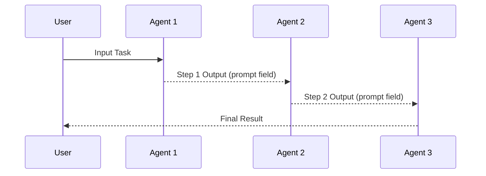

Multi-agent workflows enable Mule to tackle complex tasks by coordinating specialized AI agents. This advanced feature allows you to decompose tasks into smaller pieces, with each handled by an agent with specific expertise.

## Workflow Execution Model

The following diagram shows how multiple agents collaborate within a workflow:

```mermaid
flowchart TB
    subgraph Input["Workflow Input"]
        UserMsg[User Message]
        Context[Working Directory<br/>Repository Context]
    end

    subgraph Pipeline["Multi-Agent Pipeline"]
        A1[Analysis Agent<br/>Understand Task]
        A2[Design Agent<br/>Plan Solution]
        A3[Implementation Agent<br/>Generate Code]
        A4[Review Agent<br/>Validate & Improve]
    end

    subgraph Validation["Quality Assurance"]
        WASM[WASM Module<br/>Linting & Tests]
        Fix[Correction Loop<br/>Re-attempt if Failed]
    end

    subgraph Output["Final Output"]
        Result[Code Changes]
        Report[Status Report]
    end

    UserMsg --> A1
    Context --> A1
    A1 -->|Analysis Output| A2
    A2 -->|Design Plan| A3
    A3 -->|Generated Code| A4
    A4 -->|Reviewed Code| WASM
    WASM -->|Pass| Result
    WASM -->|Fail| Fix
    Fix --> A3
    Result --> Report

## How Multi-Agent Workflows Work

In multi-agent workflows:

1. Each agent is responsible for a specific aspect of the task
2. Agents execute in a defined sequence
3. Output from one agent becomes input for the next
4. The final result integrates all agents' contributions

This approach enables more complex reasoning and better results than using a single agent for everything.

## Workflow Components

### Agent Steps

Agent steps execute a configured AI agent. Each agent has:

- **System Prompt**: Instructions that define the agent's behavior
- **Provider**: The AI provider (e.g., Anthropic) with API credentials
- **Model ID**: The specific model to use (e.g., claude-sonnet-4-20250514)
- **Thinking Level**: Controls how much reasoning the agent performs
- **Skills**: Optional skill modules that extend agent capabilities

### WASM Module Steps

Workflows can also include WebAssembly module steps, allowing you to:

- Execute custom computation logic
- Process files or data transformations
- Integrate external tooling into workflows

### Working Directory Support

Both agents and WASM modules support working directories, enabling:

- Persistent file system state across steps
- Repository context for code-related tasks
- Shared workspace for multi-step operations

## Types of Specialized Agents

Multi-agent workflows can incorporate various specialized agents:

### Analysis Agents

These agents focus on understanding code and requirements:
- **Code analyzer**: Examines existing code to understand patterns and structure
- **Requirements analyzer**: Breaks down issue descriptions into actionable tasks
- **Test analyzer**: Evaluates test coverage and identifies test needs

### Design Agents

These agents plan solutions without writing code:
- **Architecture designer**: Creates high-level design for complex features
- **Interface designer**: Defines API contracts and interfaces
- **Database designer**: Plans data structures and relationships

### Implementation Agents

These agents write the actual code:
- **Feature implementer**: Writes code for new features
- **Bug fixer**: Creates patches for specific issues
- **Test writer**: Creates comprehensive test suites

### Validation Agents

These agents verify quality:
- **Code reviewer**: Checks code for best practices and potential issues
- **Security auditor**: Identifies security vulnerabilities
- **Performance analyzer**: Looks for optimization opportunities

## Thinking Levels

Agents support configurable thinking levels that control how much reasoning the AI performs:

| Level | Description |
|-------|-------------|
| `off` | No extended thinking |
| `minimal` | Minimal reasoning |
| `low` | Light reasoning |
| `medium` | Balanced reasoning (default) |
| `high` | Deep reasoning |
| `xhigh` | Extensive reasoning |

Higher thinking levels use more tokens but can produce better results for complex reasoning tasks.

## Skills System

Agents can be enhanced with **skills** - modular capability extensions. Skills provide:

- Specialized tools and behaviors
- Pre-configured prompts and logic
- Domain-specific knowledge

Available skills include:
- **search-cli**: Web search and content retrieval
- **spec-plan-generator**: Product specification generation
- Custom skills defined in the pi skills directory

## Example Multi-Agent Workflow

Here's an example workflow for implementing a complex feature:

```json
{
  "name": "Feature Implementation",
  "description": "Implements a new feature with analysis, planning, and testing",
  "steps": [
    {
      "step_order": 1,
      "type": "agent",
      "agent_id": "agent-uuid-1",
      "config": {}
    },
    {
      "step_order": 2,
      "type": "agent",
      "agent_id": "agent-uuid-2",
      "config": {}
    },
    {
      "step_order": 3,
      "type": "wasm_module",
      "wasm_module_id": "wasm-uuid-1",
      "config": {}
    }
  ]
}
```

### Complete Multi-Agent Workflow Example

A multi-agent workflow where output flows sequentially from step to step:

```json
{
  "name": "code-analysis-pipeline",
  "description": "Analyzes code, generates tests, and implements fixes",
  "is_async": false,
  "steps": [
    {
      "step_order": 1,
      "type": "agent",
      "agent_id": "analyzer-agent-uuid",
      "config": {}
    },
    {
      "step_order": 2,
      "type": "wasm_module",
      "wasm_module_id": "test-generator-uuid",
      "config": {
        "test_framework": "testing",
        "coverage_target": 80
      }
    },
    {
      "step_order": 3,
      "type": "agent",
      "agent_id": "fixer-agent-uuid",
      "config": {}
    },
    {
      "step_order": 4,
      "type": "wasm_module",
      "wasm_module_id": "validation-module-uuid",
      "config": {
        "validation_command": "golangci-lint run ./..."
      }
    }
  ]
}
```

**Note:** In the current implementation, each step receives the output from the previous step. The agent step output is provided as the `prompt` field to the next step. WASM modules receive the full output data and should extract what they need.

### Workflow Execution via API

Create and execute a multi-agent workflow programmatically:

```bash
# 1. Create the workflow
curl -X POST http://localhost:8140/api/v1/workflows \
  -H "Content-Type: application/json" \
  -d '{
    "name": "code-analysis-pipeline",
    "description": "Analyzes code, generates tests, and implements fixes",
    "is_async": false
  }'

# 2. Get the workflow UUID from the response
WORKFLOW_UUID="workflow-uuid"

# 3. Add step 1: Analysis agent
curl -X POST http://localhost:8140/api/v1/workflows/${WORKFLOW_UUID}/steps \
  -H "Content-Type: application/json" \
  -d '{
    "type": "agent",
    "agent_id": "analyzer-agent-uuid",
    "config": {
      "config": {}
    }
  }'

# 4. Add step 2: Test generation WASM module
curl -X POST http://localhost:8140/api/v1/workflows/${WORKFLOW_UUID}/steps \
  -H "Content-Type: application/json" \
  -d '{
    "type": "wasm_module",
    "wasm_module_id": "test-generator-uuid",
    "config": {"test_framework": "testing", "coverage_target": 80}
  }'

# 5. Reorder steps if needed
curl -X POST http://localhost:8140/api/v1/workflows/${WORKFLOW_UUID}/steps/reorder \
  -H "Content-Type: application/json" \
  -d '{
    "step_ids": ["step-1-uuid", "step-2-uuid", "step-3-uuid", "step-4-uuid"]
  }'

# 6. Execute the workflow
curl -X POST http://localhost:8140/v1/chat/completions \
  -H "Content-Type: application/json" \
  -d '{
    "model": "workflow/code-analysis-pipeline",
    "messages": [
      {"role": "user", "content": "Analyze the authentication module and fix any security issues"}
    ],
    "working_directory": "/repositories/my-project"
  }'
```

## Data Flow Between Agents

Understanding how data flows between agents is critical for building effective multi-agent workflows.

### Sequential Data Flow

Each step executes in order (by `step_order`), and the output from each step becomes the input for the next step:



### How Output Flows Between Steps

- **Agent steps**: Output a `prompt` field containing the agent's response
- **WASM modules**: Output JSON data via stdout, which becomes input for the next step
- **Step ordering**: Steps execute in ascending `step_order` order

### Step Output Format

Agent step returns:
```json
{
  "prompt": "The agent's response text"
}
```

WASM modules return whatever JSON they output, which the next step can use.

## Error Handling

When a step fails, the entire workflow fails. Currently:

- If any step fails, the job is marked as failed
- No automatic retry mechanism exists
- Jobs can be cancelled manually via the API

### Job Statuses

| Status | Description |
|--------|-------------|
| `queued` | Job waiting to be processed |
| `running` | Job currently executing |
| `completed` | All steps completed successfully |
| `failed` | A step failed or job timed out |
| `cancelled` | Job was manually cancelled |

### Timeout Configuration

Jobs have a configurable timeout (default: 1 hour). Set via `timeout_job_seconds` in settings.

## Tool-Using Agents

Agents have access to various tools that enhance their capabilities:

- **Code search**: Search and analyze codebases
- **File operations**: Read, write, and modify files
- **Command execution**: Run shell commands
- **Documentation lookup**: Access project documentation

These tools enable agents to interact with the real world and perform meaningful work.

## Extension UI Integration

Multi-agent workflows can leverage Extension UI requests for human-in-the-loop interactions. When an agent needs user input (confirmations, selections, or text input), it sends an `extension_ui_request` event.

### When to Use UI Requests

UI requests are useful for:
- **Approval workflows**: Require human approval before critical actions
- **Selection decisions**: Choose between multiple options
- **Context clarification**: Get additional input when ambiguous
- **Confirmation gates**: Confirm destructive or irreversible actions

### Workflow Example

```json
{
  "name": "code-review-workflow",
  "description": "Review code with multiple specialized agents",
  "steps": [
    {
      "step_order": 1,
      "type": "agent",
      "agent_id": "reviewer-agent-uuid",
      "config": {}
    },
    {
      "step_order": 2,
      "type": "agent",
      "agent_id": "implementer-agent-uuid",
      "config": {}
    },
    {
      "step_order": 3,
      "type": "agent",
      "agent_id": "verifier-agent-uuid",
      "config": {}
    }
  ]
}
```

For details on how agents send UI requests through the pi runtime, see the [Integrations documentation](/docs/advanced/integrations#extension-ui-requestresponse-pattern).

For details on the UI request/response pattern used by pi, see the [Integrations documentation](/docs/advanced/integrations#extension-ui-requestresponse-pattern).

## Best Practices

For effective multi-agent workflows:

1. **Clear agent responsibilities**: Each agent should have a specific, focused task
2. **Thoughtful sequencing**: Order agents logically based on dependencies
3. **Appropriate context passing**: Only pass relevant information between agents
4. **Specialized prompts**: Customize each agent's prompt for its specific task
5. **Validation between steps**: Consider adding validation between critical steps
6. **Choose appropriate thinking levels**: Use higher levels for complex reasoning, lower for simple tasks

## Example: Bug Fix Workflow

Here's a real-world example of a multi-agent workflow for fixing bugs:

1. **Bug analyzer**: Examines the issue description and related code to understand the bug
2. **Test writer**: Creates a failing test that reproduces the bug
3. **Bug fixer**: Implements a fix that makes the test pass
4. **Reviewer**: Checks the fix for potential side effects and ensures best practices

By distributing the work across specialized agents, the quality and robustness of the solution improves significantly.

## Limitations and Considerations

When planning multi-agent workflows, consider:

- **Token usage**: More agents means higher token consumption
- **Latency**: Sequential processing increases overall completion time
- **Error propagation**: Mistakes in early steps can amplify through the chain
- **Complexity management**: Balance the benefits of specialization against increased system complexity
- **Timeout handling**: Long-running workflows may hit job timeout limits (configurable in settings)

### Timeout Configuration

Jobs have a configurable timeout controlled by `timeout_job_seconds`:

| Setting | Default | Description |
|---------|---------|-------------|
| `timeout_job_seconds` | 3600s (1 hour) | Maximum time for entire job |

For complex multi-agent workflows:

```bash
# Increase job timeout via API
curl -X PUT http://localhost:8140/api/v1/settings/timeout_job_seconds \
  -H "Content-Type: application/json" \
  -d '{
    "key": "timeout_job_seconds",
    "value": "7200",
    "description": "Maximum execution time for an entire job",
    "category": "engine"
  }'
```

### Cost Optimization

To manage token costs in multi-agent workflows:

1. **Use smaller models** for simple analysis steps
2. **Limit context** by filtering unnecessary data between steps
3. **Cache results** where possible using memory tool
4. **Parallel execution** reduces wall-clock time but not token usage

### Debugging Multi-Agent Workflows

When troubleshooting multi-agent issues:

1. **Check job logs**: Each step's output is logged
2. **Verify agent configuration**: Ensure agents have correct provider/model
3. **Test agents individually**: Run each agent in isolation first
4. **Review tool permissions**: Ensure tools are assigned to agents
