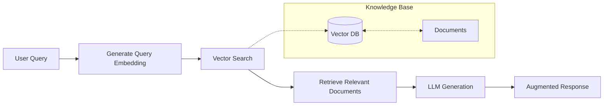

RAG (Retrieval-Augmented Generation) patterns enable agents to access and use external knowledge bases when generating responses. This is particularly useful for:

- Answering questions about specific documentation
- Maintaining context across long conversations
- Accessing proprietary or domain-specific knowledge
- Reducing hallucinations by grounding responses in factual data

## How RAG Works in Mule

The RAG system in Mule consists of three main components:



### The RAG Pipeline

1. **Ingestion**: Documents are chunked, embedded, and stored in the vector database
2. **Query Processing**: User queries are converted to embeddings
3. **Retrieval**: Similar documents are retrieved based on vector similarity
4. **Augmentation**: Retrieved context is added to the prompt
5. **Generation**: The LLM generates responses using the augmented context

## RAG Implementation in Mule

### Memory Tool as RAG Foundation

The memory tool in Mule provides the foundation for RAG functionality:

```json
{
  "operation": "store",
  "content": "The authentication service uses JWT tokens with a 24-hour expiry",
  "metadata": {
    "type": "documentation",
    "source": "auth-service/README.md",
    "tags": ["authentication", "jwt", "security"]
  }
}
```

For detailed API documentation, see the [Memory documentation](/docs/Settings/memory).

### Semantic Search Queries

Use semantic search to retrieve relevant context:

```json
{
  "operation": "retrieve",
  "query": "How does authentication work in this codebase?",
  "top_k": 5
}
```

> **Note:** The `retrieve` operation uses the `filters` parameter for metadata filtering, not `metadata`. The `metadata` parameter is only used when storing new content.

### Update Existing Content

Update stored content by ID:

```json
{
  "operation": "update",
  "id": "memory-uuid-here",
  "content": "Updated information about authentication",
  "metadata": {
    "category": "security",
    "reviewed": true
  }
}
```

### Delete Content

Remove specific content by ID:

```json
{
  "operation": "delete",
  "id": "memory-uuid-here"
}
```

## RAG Workflow Patterns

### Pattern 1: Document Q&A

Answer questions based on a knowledge base:

```json
{
  "name": "Document Q&A",
  "steps": [
    {
      "type": "WASM",
      "name": "Index Documents",
      "config": {
        "operation": "ingest",
        "directory": "/path/to/docs",
        "chunk_size": 1000
      }
    },
    {
      "type": "agent",
      "name": "Answer Question",
      "config": {
        "system_prompt": "Answer questions using the retrieved context. If the answer isn't in the context, say so."
      }
    }
  ]
}
```

### Pattern 2: Codebase Context Injection

Provide relevant code context for better responses:

```json
{
  "name": "Context-Aware Code Assistant",
  "steps": [
    {
      "type": "WASM",
      "name": "Find Relevant Code",
      "config": {
        "operation": "retrieve",
        "query": "{{user_question}}",
        "top_k": 3
      }
    },
    {
      "type": "agent",
      "name": "Generate Response",
      "config": {
        "system_prompt": "Use the provided code context to answer the user's question."
      }
    }
  ]
}
```

### Pattern 3: Multi-Source RAG

Combine information from multiple sources:

```json
{
  "name": "Multi-Source RAG",
  "steps": [
    {
      "type": "agent",
      "name": "Query Documentation",
      "config": {
        "operation": "retrieve",
        "query": "{{user_question}}",
        "source": "documentation"
      }
    },
    {
      "type": "agent",
      "name": "Query Code Examples",
      "config": {
        "operation": "retrieve",
        "query": "{{user_question}}",
        "source": "code-examples"
      }
    },
    {
      "type": "agent",
      "name": "Synthesize Answer",
      "config": {
        "system_prompt": "Combine the documentation and code examples to provide a comprehensive answer."
      }
    }
  ]
}
```

## Chunking Strategies

How you chunk your documents affects retrieval quality:

| Strategy | Best For | Chunk Size |
|----------|----------|------------|
| **Fixed-size** | Uniform content | 500-1000 tokens |
| **By paragraph** | Natural text | Varies |
| **By section** | Structured documents | Varies |
| **Recursive** | Code files | 200-500 tokens |
| **Semantic** | Complex content | Varies |

### Code Chunking Best Practices

- Split at function/class boundaries
- Include surrounding context (imports, comments)
- Preserve indentation for code readability
- Include file paths in metadata

```json
{
  "content": "function authenticate_user(credentials) {\n  // Authenticate user with JWT\n}",
  "metadata": {
    "file": "src/auth/login.js",
    "function": "authenticate_user",
    "line_start": 42,
    "language": "javascript"
  }
}
```

## Metadata Filtering

Use `filters` to filter and refine retrieval (note: `filters` is used for querying, not `metadata`):

### Filter by Category

```json
{
  "operation": "retrieve",
  "query": "API endpoints for user management",
  "top_k": 10,
  "filters": {
    "type": "api-documentation"
  }
}
```

### Filter by Date

```json
{
  "operation": "retrieve",
  "query": "Recent security updates",
  "top_k": 5,
  "filters": {
    "date_after": "2026-01-01"
  }
}
```

### Filter by Tags

```json
{
  "operation": "retrieve",
  "query": "Performance optimizations",
  "top_k": 5,
  "filters": {
    "tags": ["performance", "optimization"]
  }
}
```

## Embedding Model Selection

Choose embedding models based on your use case:

### OpenAI

| Model | Dimensions | Best For |
|-------|------------|----------|
| `text-embedding-ada-002` | 1536 | General purpose |
| `text-embedding-3-small` | 1536 | Faster, cheaper |
| `text-embedding-3-large` | 3072 | Higher quality |

### Ollama (Local)

| Model | Dimensions | Best For |
|-------|------------|----------|
| `nomic-embed-text` | 768 | General purpose, fast |
| `mxbai-embed-large` | 1024 | High quality |

## Advanced RAG Techniques

### Hybrid Search

Combine vector and keyword search:

```json
{
  "operation": "retrieve",
  "query": "authentication JWT bearer token",
  "top_k": 10,
  "hybrid": {
    "vector_weight": 0.7,
    "keyword_weight": 0.3
  }
}
```

### Re-ranking

Re-rank initial results for better relevance:

```json
{
  "operation": "retrieve",
  "query": "deployment configuration",
  "top_k": 20
}
```

Then re-rank with a cross-encoder:

```json
{
  "operation": "rerank",
  "query": "deployment configuration",
  "documents": "{{step_1.results}}",
  "top_k": 5
}
```

### Query Expansion

Expand queries to improve recall:

```json
{
  "operation": "expand_query",
  "query": "JWT auth",
  "expansions": [
    "JSON Web Token authentication",
    "token-based authentication",
    "bearer token security"
  ]
}
```

## Best Practices

### Retrieval Quality

1. **Use descriptive content**: Include context in your stored documents
2. **Add relevant metadata**: Tags, categories, and source information improve filtering
3. **Set appropriate top_k**: Too few misses relevant results, too many adds noise
4. **Use similarity thresholds**: Filter out low-similarity results

### Performance Optimization

1. **Batch embeddings**: Store multiple documents in a single operation
2. **Use cached embeddings**: Reuse embeddings for unchanged content
3. **Index strategically**: Create indexes for frequently queried metadata
4. **Limit context**: Don't overwhelm the LLM with too much context

### Cost Management

1. **Choose efficient models**: `text-embedding-3-small` is 5x cheaper than `ada-002`
2. **Use local embeddings**: Ollama with `nomic-embed-text` is free
3. **Set TTLs**: Expire old embeddings to manage storage
4. **Delete unused content**: Remove irrelevant memories regularly

## Monitoring RAG Performance

Track these metrics:

- **Retrieval latency**: Time to retrieve results
- **Hit rate**: Percentage of queries with relevant results
- **Context utilization**: How often retrieved context is used
- **Token usage**: Embedding and LLM token consumption

## Future Enhancements

Planned RAG improvements:

- **Native document ingestion**: Direct PDF, Markdown, and code file processing
- **Advanced chunking**: Semantic and recursive splitting
- **Cross-encoder re-ranking**: Better result relevance
- **Multi-modal RAG**: Support for images and diagrams
- **Streaming retrieval**: Real-time context updates

## Related Documentation

- [Memory Configuration](/docs/Settings/memory) - Complete memory tool API reference
- [Agents](/docs/Settings/agents) - Configure agents with memory access
- [Workflows](/docs/Settings/workflows) - Chain RAG operations in workflows
