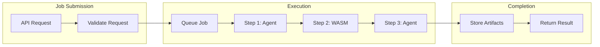

Workflows are at the heart of Mule's ability to coordinate complex AI tasks. A workflow defines a sequence of steps that Mule follows when processing issues and generating code.

## Workflow Architecture

Each workflow consists of:

- **Steps**: Individual tasks performed by agents or WASM modules
- **Input Mappings**: How data flows between steps
- **Output Fields**: What data is produced by each step
- **Job Management**: Tracking and execution of workflow runs

Workflows enable you to chain together multiple agents, each with specific responsibilities, to solve complex problems collaboratively.

## Default Workflow

Mule comes with a default workflow that serves as a starting point for customization. The default workflow:

- **Name**: "Default"
- **Description**: "Default workflow with a single agent step"
- **Async**: No (synchronous execution)
- **Steps**: Empty by default - you add steps based on your needs

The default workflow is designed as a template that you customize with your own agents and WASM modules. Unlike the default agent and provider, the workflow starts empty so you can build exactly what you need.

### Getting Started with the Default Workflow

1. Create your agents (or use the default agent)
2. Add agent or WASM module steps to the workflow
3. Execute the workflow via API or UI

```bash
# Get the default workflow
curl http://localhost:8140/api/v1/workflows

# Add an agent step to the default workflow
curl -X POST http://localhost:8140/api/v1/workflows/{workflow-id}/steps \
  -H "Content-Type: application/json" \
  -d '{
    "type": "agent",
    "agent_id": "{agent-id}",
    "config": {}
  }'
```

## Workflow Execution Flow



## Workflow Steps

Each workflow consists of ordered steps. Steps can be of two types:

### Agent Steps

Execute an AI agent to process input and generate output. Agent steps output their response as a `prompt` field.

```json
{
  "id": "unique-step-id",
  "workflow_id": "workflow-uuid",
  "step_order": 1,
  "type": "agent",
  "agent_id": "agent-uuid",
  "config": {}
}
```

### WASM Module Steps

Execute a WebAssembly module for custom processing, validation, or tooling. WASM modules receive input via stdin and output JSON via stdout.

```json
{
  "id": "unique-step-id",
  "workflow_id": "workflow-uuid",
  "step_order": 2,
  "type": "wasm_module",
  "wasm_module_id": "wasm-module-uuid",
  "config": {}
}
```

### Forge Conversation Steps

Post a templated message to a long-lived forge agent conversation and, optionally, wait for the turn's assistant reply as the step output.

```json
{
  "id": "unique-step-id",
  "workflow_id": "workflow-uuid",
  "step_order": 3,
  "type": "forge_conversation",
  "config": {
    "forge_url": "https://forge.example",
    "api_key": "sk_forge_...",
    "agent_id": "agent-uuid",
    "content": "Review this PR: {{.pr_url}}",
    "wait": true,
    "timeout_secs": 300
  }
}
```

See [Forge Conversation Steps](/docs/advanced/forge-conversations) for full addressing rules, modes (`message`, `steer`, `follow_up`, `fork`), turn-waiting semantics, and output shape.

### Step Configuration (Config Field)

The `config` JSON object is stored with the step and passed to WASM modules. For agent steps, the config is currently unused but reserved for future features.

| Field | Type | Description |
|-------|------|-------------|
| Any custom key | any | Configuration values passed to WASM modules |

### Step Properties

- **id**: A unique identifier for the step
- **workflow_id**: The UUID of the parent workflow
- **step_order**: Execution order within the workflow (1, 2, 3...)
- **type**: Step type - either `agent`, `wasm_module`, or `forge_conversation`
- **agent_id**: UUID of the agent to execute (for agent steps)
- **wasm_module_id**: UUID of the WASM module to execute (for WASM steps)
- **config**: JSON object with step-specific configuration

### Reordering Workflow Steps

You can reorder workflow steps to change their execution sequence. Use the reorder endpoint to specify a new order:

```bash
# Reorder workflow steps
curl -X POST http://localhost:8140/api/v1/workflows/{workflow_id}/steps/reorder \
  -H "Content-Type: application/json" \
  -d '{
    "step_ids": ["step-uuid-1", "step-uuid-3", "step-uuid-2"]
  }'
```

This example moves the third step to the second position. The `step_ids` array specifies the new execution order.

**Notes:**
- All step IDs must belong to the same workflow
- Steps not included in the array will be removed
- Use `GET /api/v1/workflows/{id}/steps` to get the current list of step IDs

## Step Output

Each step produces output that becomes the input for the next step:

- **Agent steps**: Output a JSON object with a `prompt` field containing the agent's response
- **WASM modules**: Output JSON data via stdout, which becomes the input for the next step

The output is passed sequentially from step to step in `step_order` ascending order.

## Working Directory Management

Workflows support working directory management across steps:

1. **Initial Directory**: When submitting a job, you can specify an initial working directory
2. **Directory Passing**: The working directory is passed to each step during execution
3. **Directory Updates**: WASM modules can set a new working directory that will be used by subsequent steps

This enables workflows to:
- Clone repositories and work within them
- Create git worktrees for parallel processing
- Maintain context across multiple steps

## Job Management

When a workflow is executed, it creates a **Job** that tracks the entire execution:

### Listing and Filtering Jobs

The Jobs API supports rich filtering and pagination:

```bash
# List recent jobs with pagination
curl "http://localhost:8140/api/v1/jobs?page=1&page_size=20"

# Filter by status
curl "http://localhost:8140/api/v1/jobs?status=failed"

# Search jobs by workflow name or working directory
curl "http://localhost:8140/api/v1/jobs?search=code-review"

# Combined filtering
curl "http://localhost:8140/api/v1/jobs?page=1&page_size=10&status=running"
```

**Query Parameters:**

| Parameter | Type | Default | Description |
|-----------|------|---------|-------------|
| `page` | integer | 1 | Page number for pagination |
| `page_size` | integer | 20 | Number of jobs per page (max: 100) |
| `status` | string | - | Filter by job status (queued, running, completed, failed, cancelled) |
| `search` | string | - | Search in workflow ID or working directory |
| `workflow_name` | string | - | Filter by workflow name |

**Response:**
```json
{
  "jobs": [
    {
      "id": "job-uuid",
      "workflow_id": "workflow-uuid",
      "workflow_name": "Code Review",
      "status": "completed",
      "working_directory": "/path/to/repo",
      "input_data": {},
      "output_data": {},
      "created_at": "2026-03-21T10:00:00Z",
      "started_at": "2026-03-21T10:00:05Z",
      "completed_at": "2026-03-21T10:05:00Z"
    }
  ],
  "page": 1,
  "page_size": 20,
  "total_count": 50,
  "total_pages": 3
}
```

### Real-Time Monitoring

Monitor workflow execution in real-time using WebSocket:

```bash
# Connect to WebSocket for live updates
ws://localhost:8140/ws

# Or via the web UI at http://localhost:8140
# Navigate to Jobs page for real-time monitoring
```

WebSocket events include:
- `job_started` - Workflow execution began
- `job_step_started` - Individual step began
- `job_step_completed` - Step finished (with output)
- `job_step_failed` - Step encountered an error
- `job_completed` - Entire workflow finished
- `job_failed` - Workflow failed

#### Per-Job Subscriptions

By default a client receives the full firehose of job events. A client can
narrow its stream by sending control messages over the same socket:

```json
{ "op": "subscribe", "job_id": "<uuid>" }
{ "op": "unsubscribe", "job_id": "<uuid>" }
{ "op": "subscribe_all" }
```

Once a client subscribes to at least one job, it receives **only** updates
for those jobs (the server echoes `{"op":"subscribed","job_id":...}`
acks). Unsubscribing from every job silences the client until
`subscribe_all` restores the full stream. Clients that never send a
subscribe op keep the backward-compatible firehose behavior.

### Job Statuses

| Status | Description |
|--------|-------------|
| `queued` | Job is waiting to be processed |
| `running` | Job is currently being executed |
| `completed` | Job finished successfully |
| `failed` | Job encountered an error |
| `cancelled` | Job was manually cancelled |

### Get a Job

Retrieve a specific job by ID:

```bash
curl http://localhost:8140/api/v1/jobs/{job_id}
```

Response includes enriched workflow and WASM module names:

```json
{
  "id": "job-uuid",
  "workflow_id": "workflow-uuid",
  "workflow_name": "Code Review",
  "status": "completed",
  "working_directory": "/path/to/repo",
  "input_data": {},
  "output_data": {
    "prompt": "Final output here"
  },
  "created_at": "2026-03-21T10:00:00Z",
  "started_at": "2026-03-21T10:00:05Z",
  "completed_at": "2026-03-21T10:05:00Z"
}
```

### Get Job Steps

View individual step executions for a job:

```bash
curl http://localhost:8140/api/v1/jobs/{job_id}/steps
```

Response:

```json
{
  "job_steps": [
    {
      "id": "job-step-uuid",
      "job_id": "job-uuid",
      "workflow_step_id": "workflow-step-uuid",
      "agent_name": "Review Agent",
      "step_order": 1,
      "status": "completed",
      "input_data": {},
      "output_data": {
        "generatedText": "Step output here"
      },
      "started_at": "2026-03-21T10:00:10Z",
      "completed_at": "2026-03-21T10:02:00Z"
    }
  ]
}
```

### Cancel a Job

Cancel a running or queued job:

```bash
curl -X DELETE http://localhost:8140/api/v1/jobs/{job_id}
```

Response:

```json
{
  "message": "Job cancelled successfully",
  "id": "job-uuid"
}
```

### Job Steps

Each workflow step execution is tracked as a **JobStep** with its own status:

| Status | Description |
|--------|-------------|
| `queued` | Step is waiting to be executed |
| `running` | Step is currently being executed |
| `completed` | Step finished successfully |
| `failed` | Step encountered an error |

### Job Timeout

Jobs have a configurable timeout controlled by the `timeout_job_seconds` setting (default: 3600 seconds / 1 hour). If a job exceeds this timeout, it will be marked as failed.

### Submitting Jobs

Jobs can be submitted via the API with optional working directory:

```bash
# Submit a job with a specific working directory
POST /api/jobs
{
  "workflow_id": "workflow-uuid",
  "working_directory": "/path/to/repository",
  "input_data": {
    "prompt": "Your input data here"
  }
}
```

## WASM Modules in Workflows

WASM modules extend workflow capabilities with custom processing logic:

### Host Functions

WASM modules have access to host functions for:

- **Git Operations**: `get_current_branch`, `create_git_branch`, `push_git_branch`, `create_git_worktree`
- **Bash Execution**: `execute_bash_command` - run shell commands with output capture
- **HTTP Requests**: `http_request`, `http_request_with_headers` - make external API calls
- **Agent/Workflow Triggers**: `trigger_workflow_or_agent` - invoke other workflows or agents
- **Job Management**: `get_job_output`, `wait_for_job_and_get_output` - monitor job execution

### Validation Modules

Validation modules are WASM modules that check code quality:

- Check code formatting
- Run linters and formatters (e.g., gofmt, golangci-lint)
- Execute tests (e.g., go test)
- Validate dependencies
- Run custom build checks

Validation modules receive the generated code as input and return validation results. If validation fails, Mule can make additional attempts to fix the issues by asking the agent to revise its output.

See the [WASM validation module example](https://github.com/mule-ai/mule/tree/main/examples/wasm/validation-module) for guidance on creating custom validators.

## Advanced: Multi-Agent Workflows

More complex tasks can benefit from specialized multi-agent workflows:

```json
{
  "id": "code-analysis-workflow",
  "name": "Code Analysis",
  "description": "Analyzes code and provides improvement suggestions",
  "is_async": false,
  "steps": [
    {
      "type": "agent",
      "agent_id": "agent-uuid-1",
      "step_order": 1,
      "config": {}
    },
    {
      "type": "agent",
      "agent_id": "agent-uuid-2",
      "step_order": 2,
      "config": {}
    },
    {
      "type": "wasm_module",
      "wasm_module_id": "wasm-module-uuid",
      "step_order": 3,
      "config": {}
    }
  ]
}
```

In this example:
1. One agent analyzes the code
2. A second agent suggests improvements
3. A WASM module validates and processes the output

## Workflow Triggers

Workflows can be triggered by:

- **Repository synchronization** (automatic)
- **Manual sync** button on the repository page
- **External triggers** from integrations (Discord, Matrix, etc.)
- **Direct API submission** of jobs

When triggered, a workflow will process any eligible issues (those labeled with `mule` that don't already have pull requests or have unresolved PR comments).

## Customizing Workflows

Mule supports sophisticated multi-agent workflows with full production capabilities:

1. **Sequential Step Execution**: Chain multiple agents with context passing
2. **WASM Module Steps**: Execute custom logic via WebAssembly modules
3. **Working Directory Management**: Maintain and update working directory across steps
4. **Job Timeout Configuration**: Set time limits for workflow execution
5. **Job Step Tracking**: Monitor individual step execution status
6. **Dynamic Output Processing**: Choose between generatedText, generatedTextWithReasoning, or raw output modes

## Best Practices

For optimal workflow performance:

- Start with simple, well-defined tasks
- Ensure agent prompts are clear and specific
- Include relevant context in issue descriptions
- Test workflows with the local provider before using with GitHub
- Review output for common errors and iterate on prompts
- Set appropriate job timeouts for complex workflows
- Use WASM modules for deterministic operations (formatting, linting, testing)